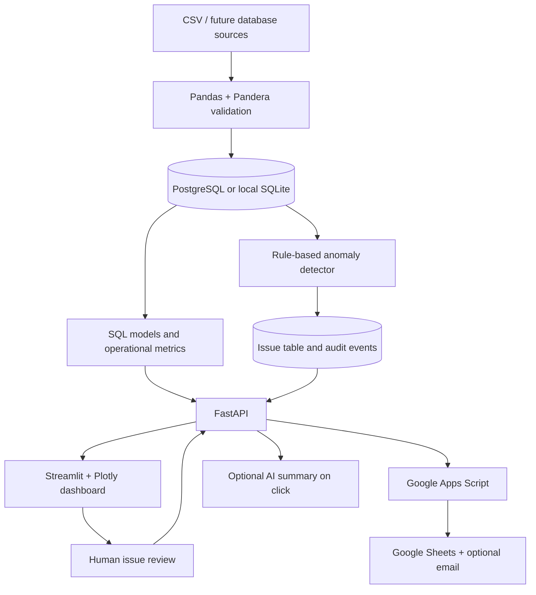
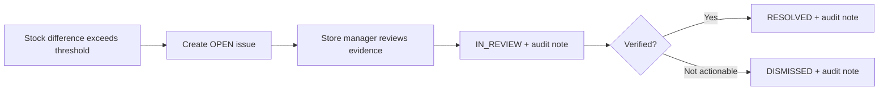

# RetailOps AI

**Multi-Site Data Intelligence & Workflow Automation Platform**  
Enterprise-style portfolio project covering **Python, SQL, PostgreSQL, Pandas, Pandera, dbt, Streamlit, Plotly, FastAPI, Google Apps Script, Google Workspace and optional LLM-assisted insights**.

> **Portfolio/demo notice:** All generated stores, products, transactions, issues and KPIs are **fictional**. The project is not affiliated with any retail company or Airbus. It is a working educational MVP, **not** a production-certified service. Verify and implement features before describing them as personal accomplishments on your CV.

## Contents

1. [What it solves](#1-what-it-solves)
2. [Features and technology choices](#2-features-and-technology-choices)
3. [Architecture](#3-architecture)
4. [Quick start with Docker](#4-quick-start-with-docker)
5. [Quick start without Docker](#5-quick-start-without-docker)
6. [How to use the application](#6-how-to-use-the-application)
7. [API documentation and examples](#7-api-documentation-and-examples)
8. [Data model and metric definitions](#8-data-model-and-metric-definitions)
9. [Ingestion, validation and anomaly detection](#9-ingestion-validation-and-anomaly-detection)
10. [Google Apps Script integration](#10-google-apps-script-integration)
11. [Optional AI insights](#11-optional-ai-insights)
12. [dbt analytical modeling](#12-dbt-analytical-modeling)
13. [Tests and quality](#13-tests-and-quality)
14. [Security and limitations](#14-security-and-limitations)
15. [Project structure](#15-project-structure)
16. [Airbus job alignment](#16-airbus-job-alignment)
17. [Suggested demo walkthrough](#17-suggested-demo-walkthrough)
18. [Extensions and roadmap](#18-extensions-and-roadmap)

## 1. What it solves

Consider a retail company with stores in Hamburg, Berlin, Munich, Paris, Lyon, Lille, Amsterdam, Rotterdam and Utrecht. Teams maintain CSV files or spreadsheets for sales, stock counts, incoming deliveries and operational issues. Data is fragmented and routine reports require manual intervention.

**RetailOps AI** provides a reusable pipeline from data sources to decisions:

1. Generate or ingest retail CSV datasets.
2. Check required fields, data types, ranges, uniqueness and foreign-key references.
3. Load clean records into a relational database using SQLAlchemy.
4. Detect stock discrepancies and delayed deliveries using transparent rules.
5. Expose KPIs and issue lists through FastAPI.
6. Explore performance in a Streamlit/Plotly application.
7. Move issues through a human-reviewed workflow and retain audit events.
8. Optionally synchronize metrics and exception queues to Google Sheets.
9. Optionally generate an evidence-grounded narrative using an LLM.

### Business questions the dashboard answers

- Which store has the greatest number of unresolved exceptions?
- What is the latest inventory accuracy for each store?
- What percentage of completed deliveries met their expected date?
- How do revenues compare across stores and regions?
- Which issues have been reviewed and who approved their resolution?

## 2. Features and technology choices

| Layer | Choice | What it does |
|---|---|---|
| Language | Python 3.12+ and SQL | Pipelines, backend, analytics |
| CSV / transformations | Pandas | Input processing, conversion and validation |
| Validation | Pandera + explicit Pandas checks | Declarative schemas and offline-safe baseline checks |
| Relational data | PostgreSQL 16 / SQLAlchemy 2 | Persistent operational records |
| Local development | SQLite | Easiest way to run without Docker |
| API | FastAPI + Pydantic | REST endpoints, request validation, API docs |
| Dashboard | Streamlit + Plotly | KPI cards, time series, filters, exception queue |
| Automation | Google Apps Script | Sheets synchronization and scheduled mail |
| Analytics models | dbt-postgres (optional) | Reusable SQL transformation, model tests |
| AI | OpenAI API (optional) | Controlled summaries on explicit request |
| Packaging | Docker Compose | API/dashboard/PostgreSQL multi-service setup |
| Tests | Pytest + FastAPI TestClient | Ingestion, business logic and API checks |

**Why not use an LLM for everything?** A late delivery is a date comparison and an inventory discrepancy is arithmetic; deterministic rules are cheaper, explainable and testable. An LLM is used only for writing a management-friendly summary from already-computed metrics.

## 3. Architecture



### One issue from detection to resolution



**Rule:** `OPEN → IN_REVIEW → RESOLVED` is allowed; `OPEN → RESOLVED` is intentionally prohibited. A reviewer can also dismiss an issue from OPEN or IN_REVIEW, with an explanatory note.

## 4. Quick start with Docker

### Prerequisites

- Docker Engine/Desktop with the Compose plugin
- Ports **8000**, **8501** and optionally **5432** available on localhost
- Approximately 2 GB of spare disk space for images and dependencies (varies by platform)

### Steps

```bash
# From the retailops-ai directory
cp .env.example .env
```

Open `.env` and change `API_KEY` to a unique value (at least 24 random characters). You do **not** need an OpenAI key to run the core application.

```bash
docker compose up --build
```

Docker Compose starts three services:

| Service | URL/connection | Purpose |
|---|---|---|
| API | http://localhost:8000/docs | OpenAPI documentation |
| Dashboard | http://localhost:8501 | User-facing app |
| PostgreSQL | localhost:5432 | Data storage / optional local dbt |

**First boot:** The API waits for PostgreSQL health, creates tables, generates fictional CSVs, ingests them, and creates issue records. The seed process skips subsequent boots when stores already exist.

Health check:

```bash
curl http://localhost:8000/health
# {"status":"ok"}
```

Stop services without deleting your database:

```bash
docker compose down
```

Reset **all** demo database content (destructive):

```bash
docker compose down -v
```

**Security:** Docker's database password is an intentionally hardcoded local-demo credential. The API, dashboard and database ports bind to `127.0.0.1` only. Do not expose this Compose file unchanged on a public server.

## 5. Quick start without Docker

**Prerequisites:** Python 3.12+ and pip. Python 3.11 may also work, but the Docker runtime uses 3.12.

```bash
# macOS / Linux
python3 -m venv .venv
source .venv/bin/activate
pip install -r requirements-dev.txt
cp .env.example .env
```

Edit `.env` and choose a secure local `API_KEY`. Keep `DATABASE_URL=sqlite:///./retailops.db` for zero-configuration local use.

Create a database and seed it:

```bash
python -m retailops.bootstrap
```

Start the API in **terminal 1**:

```bash
uvicorn retailops.api:app --reload --host 127.0.0.1 --port 8000
```

Start the dashboard in **terminal 2**, from the same project folder / active environment:

```bash
streamlit run dashboard/app.py
```

Open http://localhost:8501. Your `API_BASE_URL` in `.env` defaults to `http://localhost:8000`.

### Rebuild synthetic datasets manually

```bash
python -m retailops.generate_data --out data/sample --seed 42
python -m retailops.ingest --dir data/sample
```

Re-importing files with the same stable IDs updates existing rows rather than inserting duplicate primary keys. Importing modified historical data does not automatically re-open closed issues; use a fresh demo database when demonstrating a new seed.

## 6. How to use the application

### Dashboard tab

- Choose **All regions**, **Germany**, **France** or **Netherlands**.
- Inspect total sales revenue, inventory accuracy, on-time delivery and active exception KPIs.
- Explore daily revenue lines and exceptions per store.
- Use the operational drilldown table to compare sites.

### Issue review tab

- Filter OPEN, IN_REVIEW, RESOLVED and DISMISSED issues.
- Select a specific exception.
- Enter your reviewer identifier and a note (10+ characters).
- Move the issue to the next allowed state.
- Inspect its audit events in the same interface.

The reviewer must use an API key for write actions, and every accepted transition creates an audit event.

### Insights tab

- Read a deterministic summary based on current structured metrics.
- Optionally click **Generate an AI summary** to make a model call, if configured.

No LLM call happens on dashboard load.

## 7. API documentation and examples

Visit http://localhost:8000/docs for interactive Swagger/OpenAPI documentation.

| Method | Endpoint | Function | Auth |
|---|---|---|---|
| GET | `/health` | Health check | No |
| GET | `/api/regions` | Available regions | No |
| GET | `/api/metrics` | KPIs, site drilldowns and daily sales | No |
| GET | `/api/issues` | Issue queue with optional region/status | No |
| GET | `/api/insights` | Rule-based summary | No |
| GET | `/api/issues/{id}/audit` | View status history | API key |
| PATCH | `/api/issues/{id}` | Human-reviewed status update | API key |
| POST | `/api/insights/ai` | Explicit optional AI request | API key |

Read KPIs for Germany:

```bash
curl 'http://localhost:8000/api/metrics?region=Germany'
```

Get OPEN issues:

```bash
curl 'http://localhost:8000/api/issues?status=OPEN'
```

Move an issue from OPEN to IN_REVIEW:

```bash
curl -X PATCH 'http://localhost:8000/api/issues/PUT_REAL_ISSUE_ID_HERE' \
  -H "X-API-Key: $API_KEY" \
  -H 'Content-Type: application/json' \
  -d '{
    "status":"IN_REVIEW",
    "actor":"store-operations-reviewer",
    "note":"Checking the store count against the warehouse log"
  }'
```

> Shell note: `API_KEY` in a `.env` file is **not** automatically exported into a shell. Run `export API_KEY='your-value'` first, or supply it from your secret manager. Never commit the key.

Subsequently, you can PATCH the same ID with status `RESOLVED`, a reviewer identifier and a documented note. Invalid transitions return HTTP **409**; missing credentials return **401**. Missing issues return **404**.

### Example metric response shape

```json
{
  "summary": {
    "revenue_eur": 12345.67,
    "inventory_accuracy_pct": 97.4,
    "on_time_delivery_pct": 63.2,
    "active_issues": 12,
    "stores_tracked": 3
  },
  "by_store": [],
  "daily_sales": [],
  "definitions": {}
}
```

*Numbers shown above are illustrative, not an actual run result.*

## 8. Data model and metric definitions

| Table | Key fields | Purpose |
|---|---|---|
| `stores` | `id`, `name`, `city`, `region` | Site master data |
| `products` | `id`, `name`, `category` | Product catalog |
| `sales` | `id`, `store_id`, `product_id`, `sale_date`, `quantity`, `unit_price_eur` | Sales fact records |
| `inventory` | `id`, `store_id`, `product_id`, `snapshot_date`, `expected_qty`, `counted_qty` | Stock snapshots |
| `deliveries` | `id`, `store_id`, `product_id`, `expected_date`, `actual_date`, `quantity` | Delivery punctuality |
| `issues` | `id`, `kind`, `source_ref`, `severity`, `status`, `description` | Exception workflow |
| `audit_events` | `id`, `issue_id`, `actor`, `old_status`, `new_status`, `note` | Review traceability |

**Main relationships:** `sales`, `inventory`, `deliveries` and `issues` reference stores; product-bearing fact tables reference products; audit events reference issues. All IDs in the demo data are synthetic.

### Metric formulas

**Revenue:**

```text
Total revenue (EUR) = SUM(sales.quantity * sales.unit_price_eur)
```

**Inventory accuracy (weighted by expected units):**

```text
100 * MAX(0, 1 - SUM(ABS(expected_qty-counted_qty)) / SUM(expected_qty))
```

The computation uses **the most recent snapshot for each store/product**. When no expected units exist, accuracy is `null`/N/A.

**On-time deliveries:**

```text
100 * completed deliveries where actual_date <= expected_date
    / all completed deliveries
```

Pending deliveries are excluded from this percentage. They can still create overdue exceptions.

**Active issues:** count of OPEN and IN_REVIEW statuses.

**Caveat:** These are documented **demo KPI definitions**, not universal industry standards. The accuracy formula is a proportional quantity discrepancy metric; the delivery metric is intentionally strict (no grace period for the KPI, though alerts use >2 days lateness).

## 9. Ingestion, validation and anomaly detection

### Input contracts

Data quality checks include:

- Expected column names, with no missing or extra CSV columns.
- Nonempty identifiers and unique record IDs.
- Valid parsed dates and nonnegative inventory quantities.
- Positive integer sales/delivery quantities.
- Known regions (`Germany`, `France`, `Netherlands`).
- Referential integrity across store/product IDs.
- No duplicate stock snapshot for the same store/product/date.

Pandas checks are always executed; when Pandera is installed, a matching declarative schema runs as an additional validation layer.

All five CSVs are validated **before** the first database write. Database changes are committed in one transaction, with rollback on failure.

### Detection rules

**Inventory discrepancy:** create an issue if both conditions hold:

```python
abs(expected_qty - counted_qty) >= 3
abs(expected_qty - counted_qty) / expected_qty >= 0.08
```

When expected quantity is zero, a difference of at least 3 is an exception.

**Delivery delay:** create an issue if actual delivery is more than 2 days past expected, or if an undelivered shipment is more than 2 days overdue.

**Idempotency:** `(kind, source_ref)` is unique; re-running the detector does not duplicate the same issue.

Anomalies are not equivalent to confirmed root causes. Their resolution always requires a human review action.

## 10. Google Apps Script integration

The file [`automation/Code.gs`](automation/Code.gs) includes:

- `syncRetailOpsReport()` → retrieve metrics/issues and update three Google Sheet tabs.
- `sendDailySummary()` → send an opt-in email summary to a configured recipient.
- `onRetailOpsFormSubmit(e)` → accept a verified Google Form submission and PATCH an issue state.
- `configureDailyTrigger()` → create a daily Sheet synchronization trigger.

### Setup (requires a reachable HTTPS deployment)

1. Deploy the API behind HTTPS with authentication and access controls appropriate for your environment. The local Docker URL **cannot** be called by cloud-hosted Apps Script.
2. Create a Google Sheet. Choose **Extensions → Apps Script**.
3. Copy `automation/Code.gs` into the Apps Script editor.
4. Open **Project Settings → Script Properties** and create:

   | Property | Required | Example |
   |---|---|---|
   | `API_BASE_URL` | Yes | `https://your-private-api.example.com` |
   | `API_KEY` | Yes | The secret configured for the API |
   | `SPREADSHEET_ID` | Yes | ID from the Google Sheet URL |
   | `REPORT_EMAIL` | Only for email | An authorized internal recipient |

5. Run `syncRetailOpsReport()` manually and approve Google's authorization dialog.
6. Confirm the `KPI Summary`, `Store Performance`, and `Issue Queue` tabs appear.
7. Only if wanted, run `configureDailyTrigger()` to enable daily syncing. The script does **not** automatically send email simply by syncing. To schedule email separately, add an installable time-driven trigger for `sendDailySummary()`.

### Form-based issue review

Create Google Form fields with **exact** labels: `Issue ID`, `Next Status`, `Reviewer`, `Review Note`. Link responses to a Sheet and create a **From spreadsheet → On form submit** installable trigger for `onRetailOpsFormSubmit`.

The form alone does not establish reviewer identity or authorize a decision. Backend status rules still apply, but a production implementation needs authenticated identity mapping, role-based authorization and stronger audit semantics than a shared key.

## 11. Optional AI insights

Rule summaries run without any external model or cost:

```bash
curl http://localhost:8000/api/insights
```

To enable LLM-generated reports, set these on the **API server**:

```dotenv
OPENAI_API_KEY=your-secret-key
OPENAI_MODEL=gpt-4.1-mini
```

Then issue an explicitly authenticated POST:

```bash
curl -X POST 'http://localhost:8000/api/insights/ai?region=France' \
  -H "X-API-Key: $API_KEY"
```

### Guardrails

- No external model is needed for anomaly detection or ordinary dashboards.
- Input is limited to aggregated fictional store-level metrics.
- The request caps output and uses no automatic retries.
- The response must validate against a Pydantic model (`headline`, `summary`, `recommendations`).
- The model cannot update issues, email managers or approve remediation.
- Model narratives are marked as advisory and require verification.
- Model calls can cost money and depend on the selected model/API account being available.

This is **bounded LLM assistance, not a multi-agent system**.

## 12. dbt analytical modeling

Optional PostgreSQL SQL modeling lives in `dbt/`. The sample `mart_store_daily` view aggregates sales by store and day. It demonstrates a reusable data model with uniqueness and not-null tests.

**Note:** dbt is an optional extension and is not needed by the operational dashboard, which currently reads its metrics directly through SQLAlchemy. This avoids implying dbt is a required part of the live API.

To try dbt against the Docker-hosted PostgreSQL database:

```bash
# In a separate local Python virtual environment, install:
pip install -r requirements-dbt.txt

# Copy dbt/profiles.yml.example to ~/.dbt/profiles.yml
# Replace CHANGE_ME with the password configured in compose.yaml.
# In production, use environment-injected credentials instead.

cd dbt
dbt debug
dbt run
dbt test
dbt docs generate
```

The Docker Compose database maps PostgreSQL to local port 5432. Make sure Docker is running before executing dbt.

## 13. Tests and quality

```bash
python -m pytest -q
```

Included tests cover:

| File | Validates |
|---|---|
| `tests/test_validation.py` | CSV contracts, negative quantities, missing references, idempotent imports |
| `tests/test_analytics.py` | Anomaly thresholds, regional metrics, repeatable issue generation |
| `tests/test_api.py` | REST responses, authentication, illegal transitions, audit records, AI endpoint protection |

Local test setup uses an isolated in-memory SQLite database (not your production database) and `FastAPI.TestClient`. The external LLM is **not called** by tests. Full external integration (PostgreSQL, Google Workspace and OpenAI) requires separate controlled environments and credentials.

### CI

A minimal GitHub Actions workflow in `.github/workflows/ci.yml` installs the project dependencies and runs Pytest. It does not deploy services or publish secrets.

## 14. Security and limitations

### Already present

- Status mutation requires an API key.
- API request payloads are validated through Pydantic.
- Status transitions are controlled by a finite-state machine.
- Each accepted transition records an actor, note, previous state and next state.
- Third-party LLM errors are not returned raw to API callers.
- Credentials are read from the environment, not embedded in source modules.
- The default Docker port mappings listen on `127.0.0.1` only.
- Data is synthetic, with no customer personal information.

### **Do not expose the demo directly to the internet**

This is a portfolio MVP, not a hardened production system. Before real deployment, implement:

1. Organization sign-in (OIDC/OAuth2), role-based access control, and actual reviewer identity checks.
2. TLS termination, network restrictions, secret management, credential rotation, and managed database users.
3. Authentication/authorization for the GET reporting endpoints if data is confidential.
4. Database migrations (Alembic), backups, retention policies and audit-event tamper protection.
5. Pagination, indexing, optimized SQL aggregation and batch upserts for large data.
6. Automated scheduling/orchestration, observability, metrics, incident alerting and robust retry patterns.
7. CI with PostgreSQL integration tests, vulnerability scanning and deployment gates.
8. Privacy and contractual review before sending any real operational data to external AI services.

**Known MVP limitations:**

- Batch imports are small and deliberately use per-record SQLAlchemy merge for simplicity.
- Main dashboard metrics are calculated in application Python, not an optimized SQL warehouse query.
- There is no login, multi-tenant isolation, or granular permissions.
- Region list is a fixed demo configuration.
- Existing resolved issues are not automatically re-opened when a source row changes.
- Actual Apps Script execution needs an HTTPS deployment and Google authorization; it cannot be tested locally against `localhost`.
- dbt is packaged as an optional separate modeling example, not wired into the API's read path.

## 15. Project structure

```text
retailops-ai/
├── README.md
├── .env.example
├── .gitignore
├── Dockerfile
├── compose.yaml
├── Makefile
├── requirements.txt
├── requirements-dev.txt
├── requirements-dbt.txt
├── retailops/
│   ├── config.py             # settings
│   ├── database.py           # SQLAlchemy engine/session
│   ├── models.py             # source and workflow tables
│   ├── schemas.py            # Pydantic request/AI contracts
│   ├── generate_data.py      # entirely synthetic CSV generator
│   ├── data_quality.py       # Pandas + optional Pandera checks
│   ├── ingest.py             # validation + transactional upsert
│   ├── anomalies.py          # stock and delivery rules
│   ├── analytics.py          # operational metrics
│   ├── ai.py                 # rules + opt-in LLM narrative
│   ├── bootstrap.py          # create tables and initial demo data
│   └── api.py                # FastAPI backend
├── dashboard/
│   └── app.py                # Streamlit dashboard/issue review
├── automation/
│   └── Code.gs               # Google Apps Script
├── dbt/
│   ├── dbt_project.yml
│   ├── profiles.yml.example
│   └── models/
│       ├── sources.yml
│       └── marts/mart_store_daily.sql
├── data/sample/             # demo CSVs (generated during bootstrap)
├── tests/
│   ├── conftest.py
│   ├── test_validation.py
│   ├── test_analytics.py
│   └── test_api.py
├── docs/
│   ├── ARCHITECTURE.md
│   ├── SECURITY.md
│   └── DEMO_WALKTHROUGH.md
└── .github/workflows/ci.yml
```

## 16. Airbus job alignment

This project deliberately targets the engineering **skills**, not the aircraft manufacturing domain:

| Role requirement | Relevant work in this repository |
|---|---|
| Python + SQL | `ingest.py`, `analytics.py`, `api.py`, database schema |
| Reliable data quality | `data_quality.py`, referential integrity, tests |
| Data modeling | SQLAlchemy tables; optional dbt model and source tests |
| Interactive tools / dashboards | `dashboard/app.py` with KPI and issue-review tabs |
| Google Workspace + Apps Script | `automation/Code.gs` |
| AI-assisted tools | `ai.py` with rule-based and optional prompt-driven summaries |
| Workflow automation | Detector → issue queue → controlled state transitions |
| Technical feasibility | Architecture tradeoffs and limitation section |
| User demos & training | `docs/DEMO_WALKTHROUGH.md` |
| Documentation / data guardianship | Metric definitions, tests, architecture/security docs |

**Skywise / Palantir note:** This repository does **not** use Skywise, Foundry Workshop, Slate or Contour. Its Python/SQL analytics, dashboards and workflows are transferable skills; do not claim direct Skywise experience from this project.

## 17. Suggested demo walkthrough

See [`docs/DEMO_WALKTHROUGH.md`](docs/DEMO_WALKTHROUGH.md). A short demonstration should show:

1. A single region filter changing KPI cards and charts.
2. An inventory discrepancy visible in the OPEN issue queue.
3. A blocked direct OPEN → RESOLVED API request (409).
4. A legitimate OPEN → IN_REVIEW transition with a reviewer note.
5. A second transition to RESOLVED and the persisted audit history.
6. A rule-based insight without model cost; optional explicit AI summary.
7. A CSV validation failure and a successful repeat import.

## 18. Extensions and roadmap

**Phase A — Completed sample MVP code**: synthetic data generation, ingestion, validations, CRUD-like issue review, API, dashboard, automated tests, deterministic narratives.

**Phase B — Optional integrations to configure**: PostgreSQL runtime via Docker, Google Apps Script with HTTPS, real LLM API, dbt models.

**Phase C — Production engineering enhancements (not implemented)**: real data connectors, orchestration (Airflow/Dagster), incremental ingestion, OpenTelemetry, OpenID Connect/RBAC, per-region access control, PostgreSQL integration CI, robust event-driven notifications, and end-user training sessions.

---

### CV-safe project phrasing

Until you run and adapt this project yourself, accurately describe it as a **portfolio prototype you are developing**, not as a deployed commercial platform. Once tested, the strongest demonstrable points are the Python/SQL pipeline, interactive Streamlit dashboards, rule-based exceptions, FastAPI API and audited human-review workflow. Mention Google Apps Script or OpenAI integration as **implemented and tested** only after you have configured and verified it in your own environment.
